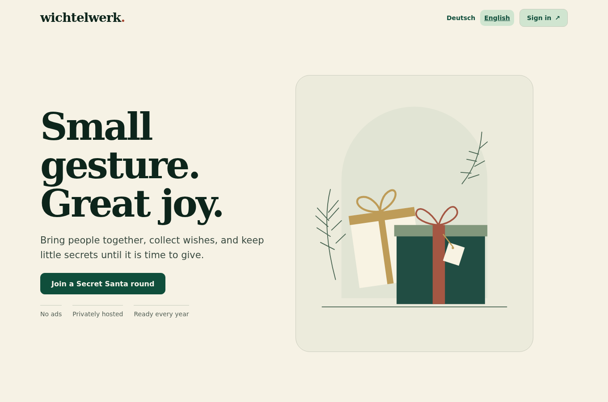
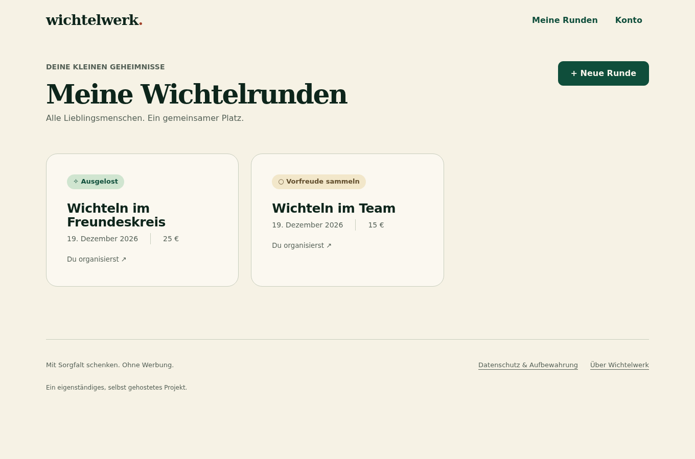
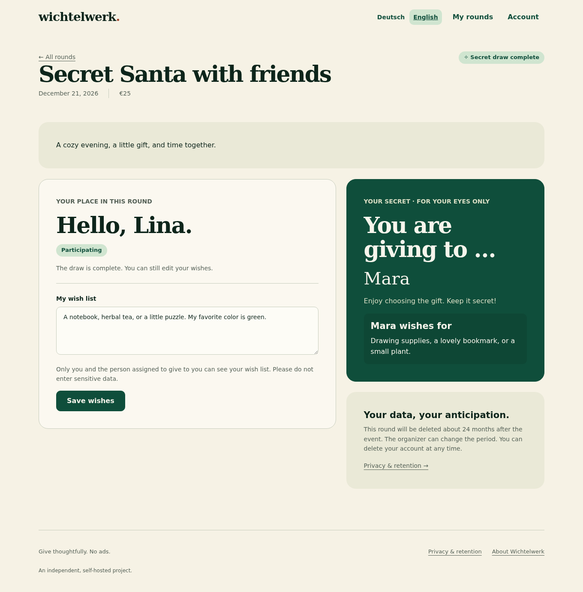
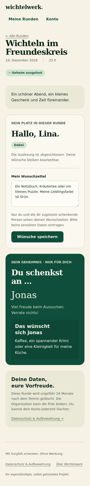

# Wichtelwerk

<p align="center">
  
</p>

A small, self-hosted Secret Santa application with **German and English interfaces**, automatic browser-language detection and a manual language switch. Organize private gift exchanges, collect wishlists and reveal each person's recipient only in their own account. Built with Flask, SQLite and plain JavaScript; no frontend build step, analytics, external fonts or image services.

## Try the demo

[Open the read-only demo](https://tofferlicious.github.io/wichtelwerk/) to explore the real interface, switch German/English, and browse sample organizer and participant screens. The demo uses fictional data and runs entirely in your browser: **no real sign-in, emails, backend or saved form submissions**. Please do not enter personal information. Form submissions show a demo notice rather than pretending to save.

The demo uses the same frontend files as the application, with a separate demo-only API adapter. To preview it locally, build into a new directory and serve it:

```sh
python3 scripts/build_demo.py _site
python3 -m http.server 8000 --directory _site
```

## Automated checks

GitHub Actions runs the Python and Chromium browser tests, lifecycle checks, JavaScript syntax checks, and a Docker build with an isolated container healthcheck on pushes and pull requests. The optional production/live test is intentionally excluded. After successful trusted pushes, it publishes the static demo to GitHub Pages. While this work is on the feature branch, both `feat/english-docker` and `main` are authorized demo sources; pull requests never deploy.

## Screenshots

Real application screens, captured locally with **synthetic demo data**. No production accounts, wishlists or assignments are shown.

### Welcome


<details>
<summary>English interface (automatically detected from the browser)</summary>



</details>

### Your rounds



### Your recipient and wishlist



<details>
<summary>Mobile view</summary>



</details>

Regenerate these screenshots using the development dependencies:

```sh
.venv/bin/python scripts/capture_screenshots.py
```

The script starts a disposable local instance, exercises the actual invitation and draw APIs, and uses memory-only email. It never connects to a production instance. Set `CHROME_PATH` if you want to use an existing Chromium installation.

## Features

- Passwordless sign-in using single-use email links.
- Email invitations and optional shared invitation links.
- Accept/decline responses, wishlists and optional postal addresses.
- Directional exclusions and a feasibility check before the final draw.
- Private recipient views: organizers do not receive an assignment list.
- Queued draw notifications with retries and visible delivery-submission status.
- Annual round copies without copying wishes, addresses or participation responses.
- Configurable retention, account deletion and round deletion.
- Creator allowlist by default; optional public creation for authenticated users.
- Responsive interface with locally served SVG artwork.

## Languages

The complete interface, dialogs, accessibility labels, date formatting, API messages and application-owned email text are available in **German and English**.

1. A saved manual choice (`ww_language` in local browser storage) takes precedence.
2. Otherwise, the app uses the first supported language in the browser's preference list, including regional variants such as `en-US`, `en-GB`, `de-DE` and `de-AT`.
3. If none is supported, it falls back to German. Blocked browser storage does not prevent using the app or switching language for the current page.

Use the language selector in the header before or after sign-in. The selected language is sent with API requests and saved for authenticated accounts so later emails can use the recipient's preference. Sign-in emails use the requesting browser's language. Invitations and reminders use the recipient's known preference, or the sender's language if unknown; background draw notifications default to German until the recipient has a preference.

Round titles, invitation messages, names, wishes and addresses are **never automatically translated**. Existing databases receive an additive language column on startup; existing accounts and rounds are retained. Back up your database before any upgrade.

## Docker Compose quick start

Requires Docker Engine and Docker Compose v2. The image is built locally from this repository; no registry login is required.

```sh
git clone https://github.com/tofferlicious/wichtelwerk.git
cd wichtelwerk
cp .env.example .env
# Edit .env: public BASE_URL, MAIL_FROM, SMTP settings and EVENT_CREATOR_EMAILS.
docker compose up -d --build
docker compose ps
```

The web service listens on **127.0.0.1:8765** on the Docker host. Put your HTTPS reverse proxy in front of it, set `BASE_URL` to that exact public origin, and keep `COOKIE_SECURE=true`. A proxy running in another container needs a shared Docker network or an explicitly configured host binding; `localhost` inside that proxy is not the Docker host.

For **local HTTP testing only**, set `BASE_URL=http://localhost:8765` and `COOKIE_SECURE=false`, recreate with `docker compose up -d`, then open that exact address. Restore secure cookies before public deployment. A fresh instance still requires your own SMTP service to send real login links; no mail server is bundled.

Both services run as a non-root user with a read-only root filesystem. The named `wichtelwerk-data` volume stores SQLite under `/data` and survives container recreation. The worker automatically runs `send-draw-mail` approximately once per minute and `cleanup` once per day (also at worker startup); **do not add duplicate host cron jobs** for this Compose deployment.

```sh
# Inspect both services, including queue submission and cleanup results.
docker compose logs --tail=100 web worker

# Upgrade source and rebuild without deleting the database volume.
git pull --ff-only
docker compose up -d --build

# Stop the stack while preserving data.
docker compose down
```

**Never use `docker compose down -v` unless you intend to delete all application data.** Keep consistent SQLite backups outside the volume and test restoration. Do not copy a live `.db` file alone while its WAL is active. For a bind mount instead of the provided named volume, its directory must be writable by UID/GID `10001:10001`; the non-root image does not change host ownership automatically.

### SMTP configuration

| Variable | Default | Meaning |
| --- | --- | --- |
| `MAIL_MODE` | `disabled` in the app; `smtp` in the example | `smtp`, existing `sendmail`, or `disabled`. Memory mail is test-only. |
| `MAIL_FROM` | `wichtelwerk@example.invalid` | Sender address accepted by your SMTP provider. |
| `SMTP_HOST` | empty | SMTP hostname; required for SMTP mode. `localhost` means the container itself. |
| `SMTP_PORT` | `587` | SMTP server port. Set `465` for typical implicit TLS configurations. |
| `SMTP_SECURITY` | `starttls` | `starttls`, `ssl` (implicit TLS), or `none` (trusted local test transport only). TLS verifies certificates and never silently downgrades. |
| `SMTP_USERNAME` / `SMTP_PASSWORD` | empty | Set both for authenticated SMTP, or leave both empty for a trusted relay. |
| `COOKIE_SECURE` | `true` | Set `false` only for deliberate local HTTP testing. |

Put credentials only in your private `.env` or process environment. Compose loads `.env`; the Python application itself does not. Neither credentials nor production data belong in the image or repository. The container distribution uses SMTP; the existing `sendmail` path remains available for manual host installations, not in the standard image.

## Manual Python installation

Requires Python 3.11+ and a Unix-like server. Use either a reachable SMTP server (`MAIL_MODE=smtp`, settings above) or an existing `/usr/sbin/sendmail` interface (`MAIL_MODE=sendmail`).

```sh
git clone https://github.com/tofferlicious/wichtelwerk.git
cd wichtelwerk
python3 -m venv .venv
.venv/bin/python -m pip install -r requirements.txt
```

Configure the process environment, using your own hostname, sender and verified login email:

```sh
export DATABASE="$PWD/instance/wichtelwerk.db"
export BASE_URL="https://wichtelwerk.example.com"
export MAIL_MODE="sendmail"
export MAIL_FROM="wichtelwerk@example.com"
export PUBLIC_EVENT_CREATION="false"
export EVENT_CREATOR_EMAILS="admin@example.com"

.venv/bin/gunicorn --bind 127.0.0.1:8765 --workers 2 'wichtelwerk:create_app()'
```

Place an HTTPS reverse proxy in front of Gunicorn. Cookies are secure by default; use HTTPS for real sign-in. Set `BASE_URL` to the exact public origin without a path. Uberspace requires binding to `0.0.0.0:8765` rather than loopback and registering the dedicated domain backend.

The database schema initializes automatically. Keep the database and backups outside publicly served paths. `.env.example` documents the variables but **is not automatically loaded**; export them or set them in your process manager. Keep the same database, URL and mail settings for maintenance workers. Restart the web application after configuration changes.

## Who can create rounds?

| Variable | Default | Meaning |
| --- | --- | --- |
| `PUBLIC_EVENT_CREATION` | `false` | If explicitly enabled, all authenticated users may create rounds. |
| `EVENT_CREATOR_EMAILS` | empty | Comma-separated allowlist of login email addresses permitted to create and copy rounds. |

With the defaults, nobody can create rounds. There is no automatic first-user administrator. Allowlist matching is exact after trimming/lowercasing; no wildcard or implicit email aliases are supported. The switch accepts `true/false`, `1/0`, `yes/no` or `on/off`; invalid values abort startup.

The backend enforces this policy for both creation and copying; hiding controls is not the security boundary. Ordinary users can still sign in, accept invitations, join an enabled invitation link and edit their own wishes. Existing ownership remains intact, but a former creator without current permission cannot copy a round. Enabling public creation does not grant access to other users' rounds. The allowlist is not a global administration role.

## Maintenance

For manual Python installations, schedule these commands with your process manager or cron, using the same exported environment as the web application. Docker Compose already runs them in its worker:

```sh
# Run approximately once per minute to submit queued draw notifications.
.venv/bin/flask --app 'wichtelwerk:create_app()' send-draw-mail

# Run daily to remove expired rounds, links, sessions and rate-limit entries.
.venv/bin/flask --app 'wichtelwerk:create_app()' cleanup
```

Run `/healthz` for a basic application/database health check. Back up SQLite consistently, including its WAL state; copying only a live `.db` file is not a backup strategy. Preserve production data on upgrades and never replace it with a development database.

## Tests

```sh
.venv/bin/python -m pip install -r requirements-dev.txt
.venv/bin/python -m playwright install chromium
.venv/bin/python -m pytest -q
.venv/bin/python verify_lifecycle.py
```

If Chromium is already installed, set `CHROME_PATH=/path/to/chrome` instead of downloading another copy. Tests use temporary SQLite databases and memory-only mail, exercising creator permissions, anonymous denial, invitations, wishlists, draw privacy, notification queues and desktop/mobile controls.

An optional **read-only** deployment check is skipped unless you explicitly set `WICHTEL_TEST_URL=https://your-host.example`. It checks the public landing page and login form; it does not send email. The test suite does not prove inbox delivery.

## Security and limitations

- Assignment privacy is server-side access control, **not end-to-end encryption**. The server operator can access the database. Small groups or strong exclusions can make assignments logically inferable.
- Draws are final. The matching algorithm randomizes valid assignments but does not sample them uniformly. Previous-year assignments are not reused as exclusion constraints.
- Mail status means submitted to the mail service, not delivered or read. The notification worker uses at-least-once delivery; a crash around submission can produce duplicates.
- Retention months are approximated as 31 days. Accounts persist until explicitly deleted; expired rounds are removed by the cleanup command.
- Basic protections include CSRF checks, single-use login tokens, secure cookies, access checks, rate limits and a restrictive content security policy. This project has automated tests, not an independent comprehensive security audit.
- Before offering a public instance, supply your own legally appropriate operator/contact information and privacy notice; the built-in page describes technical behavior only.

This repository contains application code, synthetic tests and generic configuration examples—no production accounts, rounds, mail outboxes or credentials.

## License

[MIT](LICENSE). The included SVG illustrations are part of the project and use the same license.
